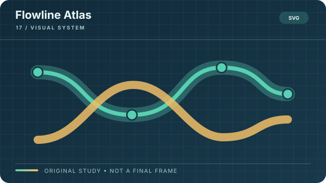

# Flowline Atlas

**Style ID:** `flowline-atlas`  
**Visual signature:** Flow bands, moving tokens, proportional widths, visible destinations  
**Best suited for:** Supply chains, money, energy, logistics  
**Example concept:** Where a dollar goes after a customer spends it

[← Back to the SceneRail Style Atlas](../STYLEBOOK.md#flowline-atlas)

Illustrative style study, not a finished video frame or factual evidence.

## Style recipe

**Look:** paths or bands whose width and direction represent movement through a system.  
**Motion:** follow the item as it transfers between stages; keep the destination visible.  
**Rules:** make clear whether flow width is proportional or merely illustrative. Avoid changing quantities midstream without explaining losses, conversion, or units.

## Production checklist

- **Composition:** define a focal point and a reading order that still works at phone size.
- **Palette and type:** specify color meanings, contrast, type hierarchy, and safe margins in the style bible.
- **Motion:** animate to explain, compare, reveal, or transition; keep frame timing deterministic.
- **Continuity:** reuse the same materials, line weights, object language, and transition grammar across scenes.
- **Audio:** coordinate narration, captions, music, and sound effects with the canonical timeline.
- **Evidence:** distinguish a conceptual illustration from real footage, data, or a technical drawing.
- **Review:** inspect an opening frame, a dense information frame, and a closing frame at final output size.

## Avoid

Do not add decoration just because the frame feels empty. Do not animate data in a way that changes its meaning. Do not present generated or recreated imagery as authentic evidence. Keep the visual direction coherent.
