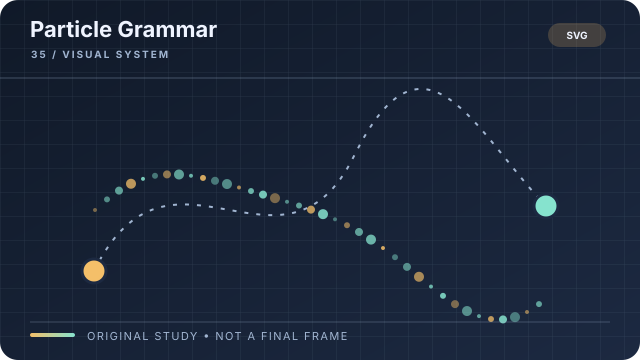

# Particle Grammar

**Style ID:** `particle-grammar`  
**Visual signature:** Particles obey a visible rule and form explanatory shapes  
**Best suited for:** Physics, scale, emergence  
**Example concept:** How many small interactions create a large pattern

[← Back to the SceneRail Style Atlas](../STYLEBOOK.md#particle-grammar)

Illustrative style study, not a finished video frame or factual evidence.

## Style recipe

**Look:** particles follow a visible organizing rule: cluster, spread, align, split or converge.  
**Motion:** show the rule first, then let the system evolve into the meaningful form.  
**Rules:** control particle count and deterministic seeds. Never imply that an artistic simulation is a scientifically validated model.

## Production checklist

- **Composition:** define a focal point and a reading order that still works at phone size.
- **Palette and type:** specify color meanings, contrast, type hierarchy, and safe margins in the style bible.
- **Motion:** animate to explain, compare, reveal, or transition; keep frame timing deterministic.
- **Continuity:** reuse the same materials, line weights, object language, and transition grammar across scenes.
- **Audio:** coordinate narration, captions, music, and sound effects with the canonical timeline.
- **Evidence:** distinguish a conceptual illustration from real footage, data, or a technical drawing.
- **Review:** inspect an opening frame, a dense information frame, and a closing frame at final output size.

## Avoid

Do not add decoration just because the frame feels empty. Do not animate data in a way that changes its meaning. Do not present generated or recreated imagery as authentic evidence. Keep the visual direction coherent.
