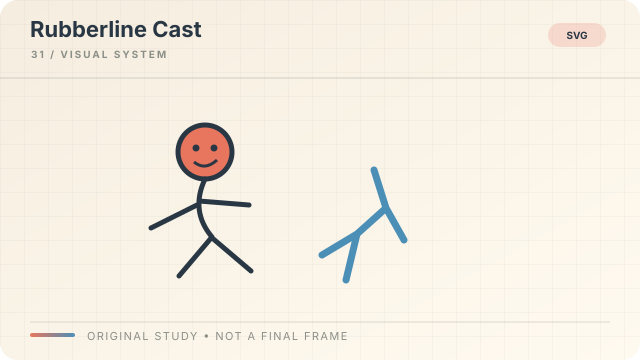

# Rubberline Cast

**Style ID:** `rubberline-cast`  
**Visual signature:** Simple elastic characters, expressive poses, reusable character shapes  
**Best suited for:** Light educational stories, everyday economics  
**Example concept:** A customer and a shopkeeper negotiate a price

[← Back to the SceneRail Style Atlas](../STYLEBOOK.md#rubberline-cast)

Illustrative style study, not a finished video frame or factual evidence.

## Style recipe

**Look:** simple reusable characters, expressive poses, consistent outlines and clear props.  
**Motion:** gesture, reaction and object handoff should communicate the beat even with audio muted.  
**Rules:** keep character scale, anatomy and identity consistent from scene to scene. Avoid unnecessary lip-sync when narration is not character dialogue.

## Production checklist

- **Composition:** define a focal point and a reading order that still works at phone size.
- **Palette and type:** specify color meanings, contrast, type hierarchy, and safe margins in the style bible.
- **Motion:** animate to explain, compare, reveal, or transition; keep frame timing deterministic.
- **Continuity:** reuse the same materials, line weights, object language, and transition grammar across scenes.
- **Audio:** coordinate narration, captions, music, and sound effects with the canonical timeline.
- **Evidence:** distinguish a conceptual illustration from real footage, data, or a technical drawing.
- **Review:** inspect an opening frame, a dense information frame, and a closing frame at final output size.

## Avoid

Do not add decoration just because the frame feels empty. Do not animate data in a way that changes its meaning. Do not present generated or recreated imagery as authentic evidence. Keep the visual direction coherent.
