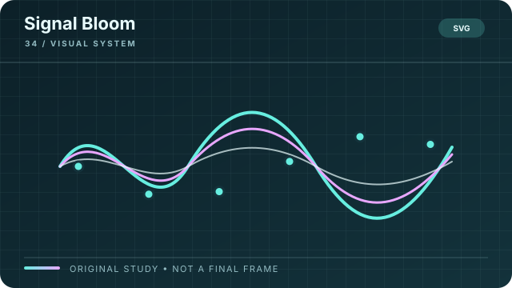

# Signal Bloom

**Style ID:** `signal-bloom`  
**Visual signature:** Procedural line fields and controlled light transitions  
**Best suited for:** Networks, signals, invisible systems  
**Example concept:** How information spreads through a network

[← Back to the SceneRail Style Atlas](../STYLEBOOK.md#signal-bloom)

Illustrative style study, not a finished video frame or factual evidence.

## Style recipe

**Look:** procedural lines, fields, waves and restrained glow around a clear focal point.  
**Motion:** animate from frame/time inputs; seed randomness so renders are repeatable.  
**Rules:** effects must expose a pattern or relationship. Avoid particle soup, uncontrolled flicker and costly effects that add no explanatory value.

## Production checklist

- **Composition:** define a focal point and a reading order that still works at phone size.
- **Palette and type:** specify color meanings, contrast, type hierarchy, and safe margins in the style bible.
- **Motion:** animate to explain, compare, reveal, or transition; keep frame timing deterministic.
- **Continuity:** reuse the same materials, line weights, object language, and transition grammar across scenes.
- **Audio:** coordinate narration, captions, music, and sound effects with the canonical timeline.
- **Evidence:** distinguish a conceptual illustration from real footage, data, or a technical drawing.
- **Review:** inspect an opening frame, a dense information frame, and a closing frame at final output size.

## Avoid

Do not add decoration just because the frame feels empty. Do not animate data in a way that changes its meaning. Do not present generated or recreated imagery as authentic evidence. Keep the visual direction coherent.
